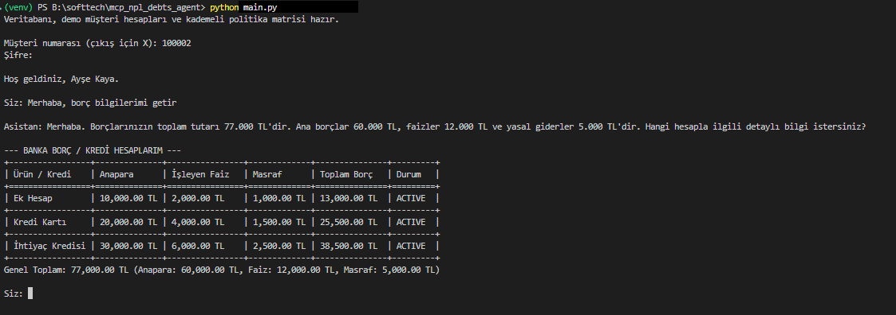
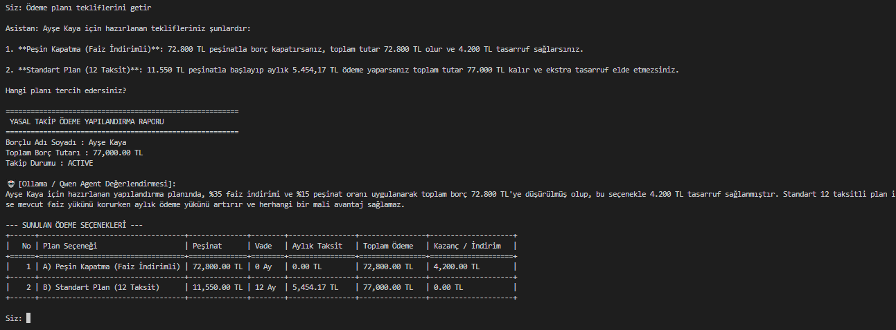
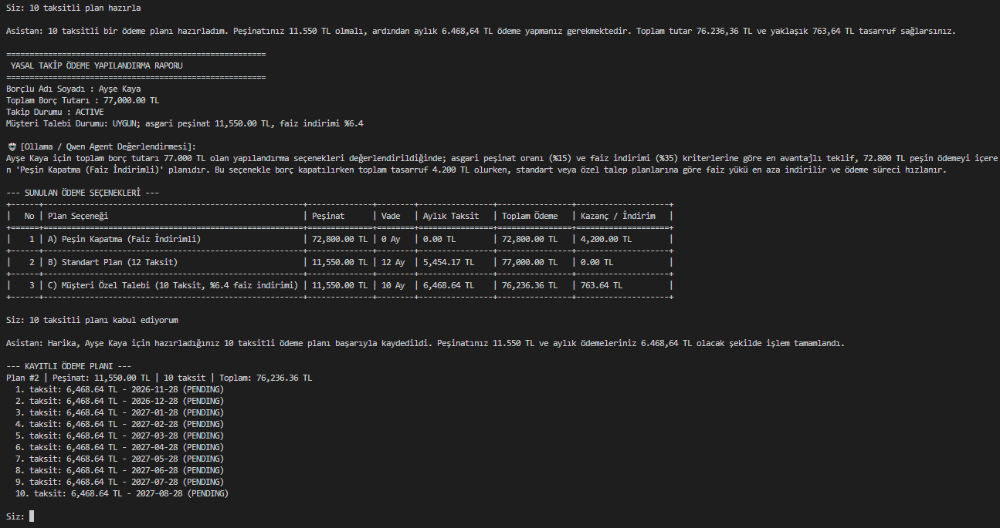
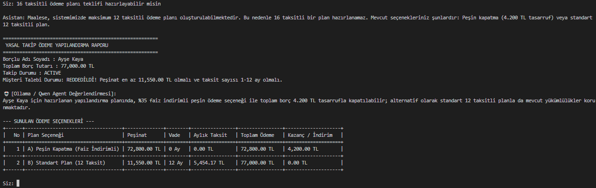
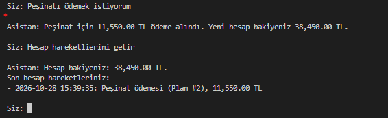
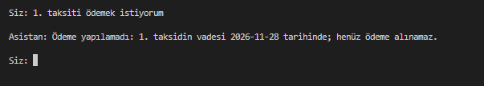

# MCP NPL Debts Agent (Banka Takip ve Borç Yönetim Asistanı)

Bu proje, banka borçlarını sorgulamak, ödeme planı tekliflerini değerlendirmek ve demo banka hesabından kurallara uygun ödeme yapmak için geliştirilmiş yerel bir asistandır. Türkçe kullanıcı mesajlarını yerel Ollama modeliyle yorumlar; doğrulanmış borç, plan ve hesap işlemlerini MCP araçları üzerinden çalıştırır. Uygulama gerçek bankacılık sistemlerine bağlanmaz; SQLite veritabanlarındaki örnek verilerle çalışır.

---

## 🛠️ Sistem Mimarisi ve Bileşenler

Proje modüler bir ajan mimarisiyle kurulmuştur:
* **Orchestrator:** Kullanıcı talebini sınıflandırır, konuşmanın teklif/onay aşamalarını takip eder ve gerekli aracı çağırır.
* **Account Agent ve Payment Agent:** Hesap hareketi ve ödeme görevlerini MCP istemcisi üzerinden yürütür.
* **MCP Server (`mcp_servers/debt_mcp_server.py`):** MCP Python SDK ile borç, ödeme planı, bakiye ve ödeme araçlarını standart MCP araçları olarak sunar.
* **MCP Client (`mcp_servers/client.py`):** Yerel MCP sunucusunu `stdio` taşımasıyla başlatır, araç listesini keşfeder ve çağrıları MCP protokolüyle yapar.
* **Ollama:** Mesaj sınıflandırma ve Türkçe yanıt üretimi yerel modelle yapılır. Veritabanı işlemleri LLM tarafından değil, Python araçları ve iş kuralları tarafından yürütülür.

MCP araçları: `get_debtor_info`, `get_customer_debts`, `get_payment_plan_history`, `get_policy_rules`, `save_payment_plan`, `get_account_activity` ve `pay_payment_plan`.

MCP sunucusu ve istemcisi aynı bilgisayarda çalışır. `stdio` yerel süreçler arası iletişimi kullanır; sunucu barındırma veya MCP kullanımı için ücret alınmaz. Ollama ve gerekli model indirmeleri ilk kurulumda internet kullanır. Uygulama kodu ücretli bir bulut LLM API'sine bağlanmaz.

### Temel Teknolojiler ve Seçim Nedenleri

| Teknoloji | Kullanım amacı |
|---|---|
| Python 3.12 | Orkestrasyon, ajanlar ve borç/ödeme iş kuralları |
| Ollama + Qwen 3.5 4B | Türkçe mesaj sınıflandırma ve yanıt üretimini yerel çalıştırma |
| MCP Python SDK | Araçları istemciden/sunucudan bağımsız, standart protokolle sunma |
| SQLite | Harici veritabanı servisi olmadan tekrarlanabilir demo borç ve banka verisi |
| LangChain Ollama | Yerel sohbet modeline yapılandırılmış JSON çağrıları |

---

## 🚀 Kurulum Rehberi

Projeyi kendi bilgisayarınızda kurup çalıştırmak için aşağıdaki adımları takip edin:

### 1. Gereksinimler
* **Python 3.12+**
* **Ollama** (yerel LLM çalıştırmak için)
* Modeli yerel çalıştırmaya yetecek RAM/disk kapasitesi (Qwen 3.5 4B model dosyası indirilir).

### 2. Projeyi Klonlayın

GitHub'dan temiz kurulum için repository'yi klonlayın:
```bash
git clone <repository-url>
cd mcp_npl_debts_agent
```
Proje dosyaları zaten bilgisayarınızdaysa terminalde proje klasörüne geçin:
```bash
cd mcp_npl_debts_agent
```

### 3. Sanal Ortam (Virtual Environment) Oluşturun ve Aktifleştirin
```bash
python -m venv venv
# Windows için:
venv\Scripts\activate
# macOS / Linux için:
source venv/bin/activate
```

### 4. Bağımlılıkları Yükleyin
```bash
pip install -r requirements.txt
```

### 5. Ollama ve Model Kurulumu
Sistemin yerel olarak Qwen modelini kullanabilmesi için Ollama'nın kurulu ve çalışır durumda olması gerekir:
1. [Ollama Resmi Sitesi](https://ollama.com/) üzerinden Ollama'yı indirip başlatın.
2. Terminal üzerinden yapılandırılmış Qwen modelini indirin:
   ```bash
   ollama pull qwen3.5:4b
   ```
3. Ollama servisinin arka planda çalıştığından emin olun (varsayılan adres: `http://localhost:11434`).

### 6. Ortam Değişkenleri (`.env`) Yapılandırması
Proje ana dizininde bulunan `.env.example` dosyasını `.env` olarak kopyalayın. Windows PowerShell'de:
```bash
Copy-Item .env.example .env
```
macOS/Linux'ta `cp .env.example .env` komutunu kullanabilirsiniz. Örnek ayarlar:
```env
OLLAMA_BASE_URL=http://localhost:11434
OLLAMA_MODEL=qwen3.5:4b
DB_PATH=debt_collection.db
BANK_DB_PATH=bank_accounts.db
```

---

## 🗄️ Veritabanı Hazırlığı

Sistemin çalışması için SQLite tablolarının oluşturulması ve örnek verilerin yüklenmesi gerekir:
```python
python database/db_setup.py
```
Bu komut `bank_accounts.db` ve `debt_collection.db` dosyalarını oluşturur. Mevcut veritabanı dosyaları varsa başlangıç verilerini tekrar yüklemez ve mevcut hesap bakiyelerini korur.

---

## 🏃‍♂️ Projeyi Çalıştırma

Konsol uygulamasını başlatın:
```bash
python main.py
```

Uygulama, gereken MCP sunucusunu yerel bir alt süreç olarak başlatıp `stdio` üzerinden bağlanır. MCP sunucusunu bağımsız olarak başlatmak veya başka bir MCP host'undan kullanmak için:
```bash
python -m mcp_servers.debt_mcp_server
```
Bu komut standart MCP `stdio` iletişim kanalını kullanır; doğrudan terminal sohbeti başlatmaz.

Demo giriş bilgileri:

| Müşteri No | Şifre | Demo kullanıcı |
|---|---|---|
| `100001` | `Ahmet123!` | Ahmet Yılmaz |
| `100002` | `Ayse123!` | Ayşe Kaya |
| `100003` | `Mehmet123!` | Mehmet Demir |

Parola terminalde gösterilmeden alınır. Bu bilgiler yalnızca yerel demo içindir; gerçek hesaplarda kullanılmamalıdır.

Örnek konuşmalar:
* "Borç bilgilerimi görüntüle"
* "Ödeme planı tekliflerini getir"
* "6 taksitli planı kabul ediyorum"
* "Peşinatımı öde"
* "Hesap bakiyemi ve son işlemimi göster"

### Uygulama Görselleri

Görseller, demo müşteri hesabıyla uygulamanın gerçek konsol akışlarından alınmıştır. Ödeme ve hesap hareketleri yerel demo veritabanındaki örnek işlemlerdir; gerçek banka işlemi değildir.

#### Borç sorgulama



#### Ödeme planı teklifleri ve özel plan oluşturma







#### Ödeme ve hesap hareketleri





---

## 🧪 Testlerin Çalıştırılması

Projedeki iş akışlarını ve yerel MCP istemci-sunucu araç çağrılarını doğrulamak için:
```bash
python -m unittest tests.test_customer_debt_flow
```

---

## 📂 Proje Dosya Yapısı

```text
mcp_npl_debts_agent/
│
├── agents/
│   ├── __init__.py
│   ├── account_agent.py      # Hesap ve borç sorgulama ajanı
│   ├── payment_agent.py      # Ödeme planı ve yapılandırma ajanı
│   └── orchestrator.py       # Görev dağılım ve yönetim ajanı
│
├── config/
│   └── settings.py           # Konfigürasyon ve ortam ayarları
│
├── database/
│   ├── auth.py               # Yetkilendirme ve güvenlik araçları
│   ├── bank_tools.py         # Bankacılık entegrasyon araçları
│   ├── db_setup.py           # Veritabanı oluşturma betiği
│   └── db_tools.py           # SQL sorgu ve veri yönetim araçları
│
├── mcp_servers/
│   ├── client.py             # Yerel stdio MCP istemcisi
│   └── debt_mcp_server.py    # MCP araç sunucusu
│
├── tests/
│   └── test_customer_debt_flow.py # Entegrasyon ve akış testleri
├── screenshots/              # İzole demo akışlarının uygulama çıktıları
│
├── .gitignore                # Yerel sırları, veritabanlarını ve sanal ortamı dışlar
├── .env.example              # Örnek ortam değişkenleri
├── main.py                   # Uygulama giriş noktası
├── requirements.txt          # Python paket bağımlılıkları
└── README.md                 # Proje dokümantasyonu
```

## Demo ve Güvenlik Sınırları

* `bank_accounts.db` içindeki bakiyeler ve hareketler demo verisidir; gerçek bankada para transferi yapılmaz.
* Ödemeler yalnızca kayıtlı demo planına, ödeme sırasına, vadeye ve mevcut demo bakiyesine göre yerel SQLite veritabanında kaydedilir.
* Konuşma geçmişi uygulama oturumu belleğinde tutulur; kalıcı sohbet hafızası yoktur.
* Demo müşteri parolaları ve örnek kişisel bilgiler gerçek kullanıcı bilgisi olarak kullanılmamalıdır.
* `.env`, sanal ortamlar, veritabanları ve Python önbellekleri Git'e eklenmemelidir; `.gitignore` bu yerel dosyaları dışarıda tutar.